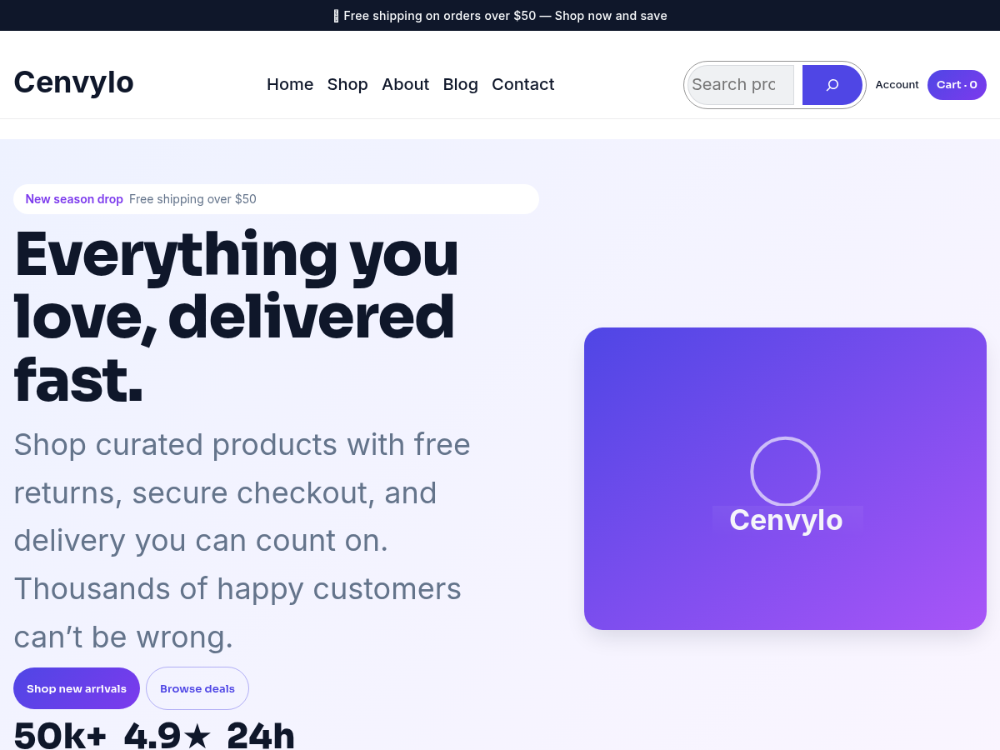

<h1 align="center">Cenvylo</h1>

<b>Fast, accessible, WooCommerce-ready full site editing block theme for modern online stores.</b>

  
  

Free WordPress theme · Version 1.0.1 · GPLv2 or later

> [!NOTE]
> Cenvylo is officially distributed through **WordPress.org**. Please download, install and get updates from its [WordPress.org page](https://wordpress.org/themes/cenvylo/) so you always have the latest reviewed version.

## About

Cenvylo is a fast, accessible, WooCommerce-ready full site editing block theme built for modern online stores. It ships a complete design system via theme.json, 20+ block patterns, multiple header and footer layouts, polished product cards, and mobile-first, WCAG-friendly markup. No page builders or bundled plugins required — just clean, future-proof blocks.

## Requirements

- WordPress 6.5 or higher
- PHP 7.4 or higher

## How to install

1. In your WordPress dashboard go to **Appearance → Themes → Add New Theme**.
2. Search for **Cenvylo**.
3. Click **Install Now**, then **Activate**.

Or download it directly from **[WordPress.org](https://wordpress.org/themes/cenvylo/)**.

## Support

Questions or problems? Please use the **[support forum on WordPress.org](https://wordpress.org/support/theme/cenvylo/)**.

## Author

Developed by **[Muhammad Mujahid Sarfraz](https://profiles.wordpress.org/mujahidwp/)** · [All my WordPress products](https://profiles.wordpress.org/mujahidwp/) · [LinkedIn](https://www.linkedin.com/in/muhammad-mujahid-sarfraz-2631a43b6)
